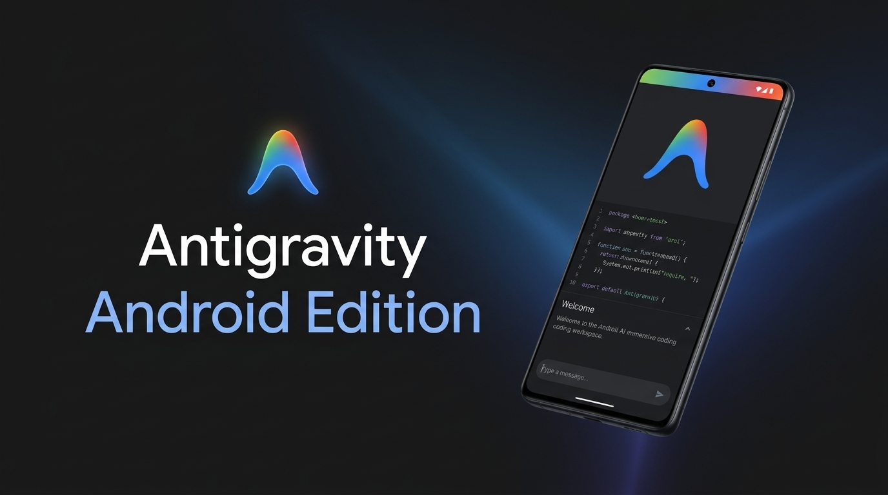

# Antigravity Android



**反重力安卓版** —— [Google Antigravity](https://antigravity.google.com) 的轻量级原生体验安卓客户端（非官方开源封装）。

## 特性

- **启动即用**：内置独立浏览器内核，冷启动直达 Antigravity，支持 Google 账号登录、OAuth 弹窗与 Cookie 持久化。
- **原生启动过渡**：深色启动 Logo 界面在后台静默加载页面，就绪后平滑淡出，告别白屏与生硬进度条。
- **沉浸式自适应状态栏**：实时采样网页标头真实背景色并平滑过渡，状态栏时间/电量图标自动适配深浅反色。
- **完整移动交互**：支持文件上传、系统下载接管、手势/返回键历史回退与双击防误触退出。

## 下载安装

前往 [Releases](https://github.com/jae-jae/antigravity-android/releases) 下载最新的 `Antigravity-v1.0.3-release.apk`（支持 Android 7.0 及以上系统）。

## 本地构建

```bash
./gradlew assembleRelease
```

产物位于 `app/build/outputs/apk/release/`（需自行配置 `app/keystore/antigravity-release.jks` 签名或使用 `./gradlew assembleDebug`）。

## 许可与声明

基于 [MIT License](./LICENSE) 开源。本项目为第三方轻量封装工具，与 Google 官方无隶属关系。
